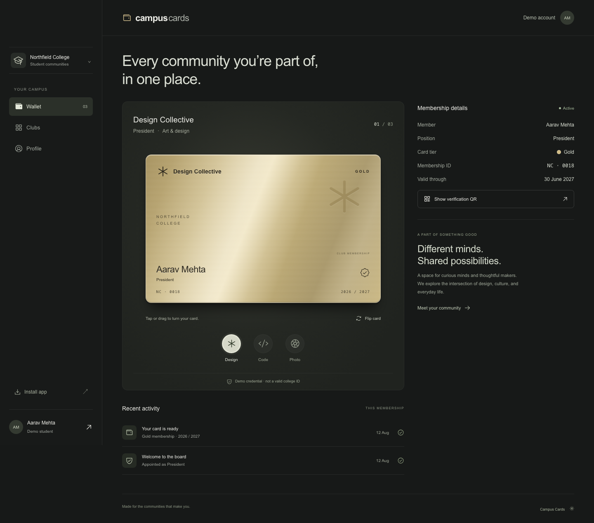
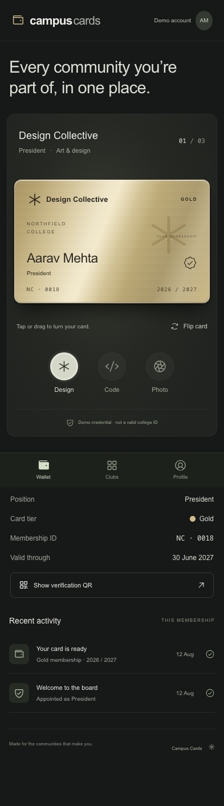
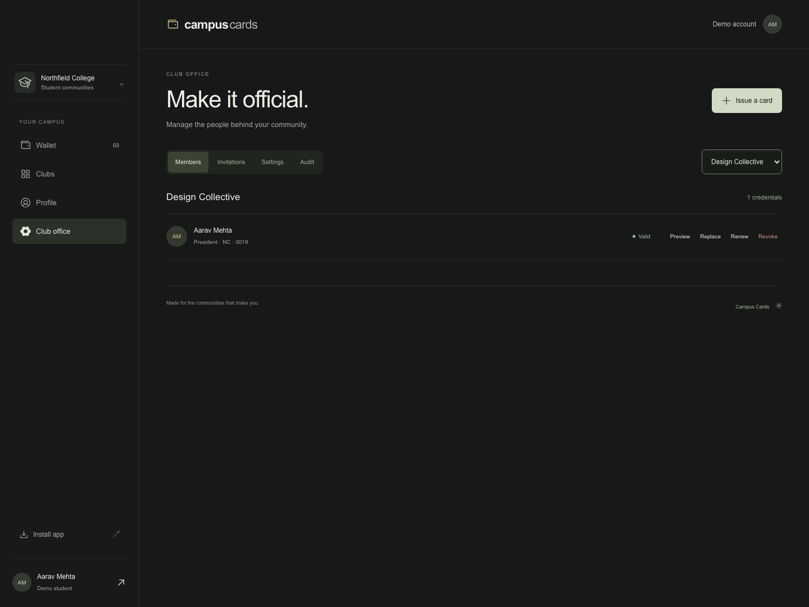
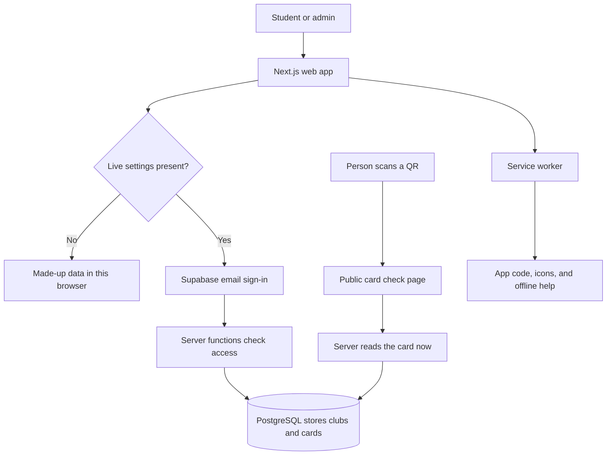
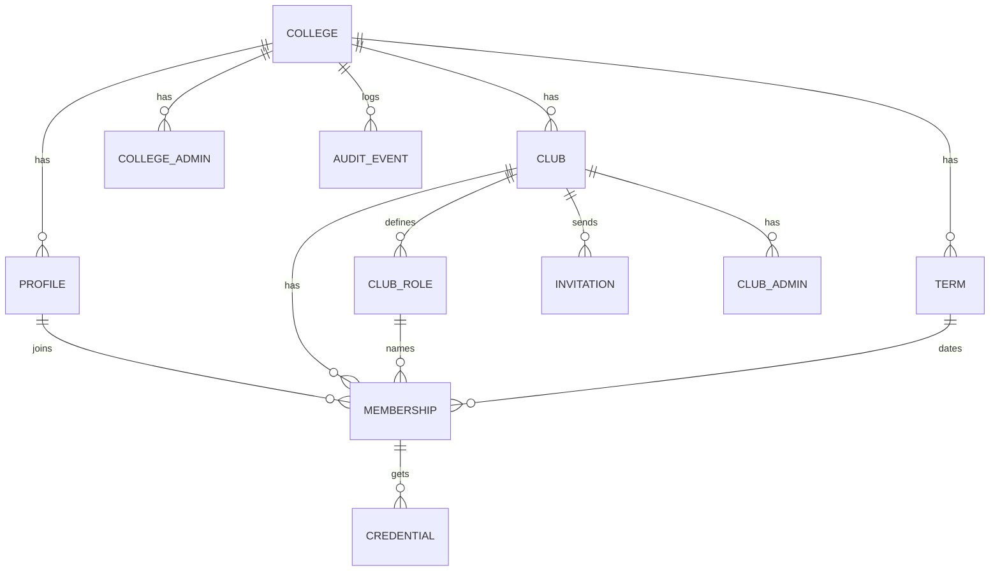

# Campus Cards

A home for all your college club cards.

Campus Cards is a web app for college clubs. Each student can have a card for each club they join. The cards have a gold, silver, or bronze metal look. You can tilt, tap, drag, and flip them.

**Project state:** The demo works with made-up people and saves changes in your browser. The live data code and SQL rules are included. A real Supabase project is still needed for real sign-in and live QR checks. Do not use the demo as a real college ID system.

## Why we chose this problem

A college has many clubs. Each club has a team. It can be hard to know who is on that team and what each person does.

A paper card can get lost. A photo of an old card can still look real. A list in a chat can get out of date.

We want one clear place to keep club cards. We also want a quick way to check if a card is still in use. A card should feel like a small sign that you belong.

## How we solve it

1. A club admin makes an invite for a student.
2. The student opens the link and signs in with the right email.
3. The student accepts the invite.
4. A card shows up in their wallet.
5. A person scans the QR code to check the card.
6. If the club stops the card, the old QR code no longer shows an active card.

A QR check shows the **card’s state**. It does not prove who is holding the phone. A copied photo is not proof of who a person is.

## The card colors

| Card   | Who gets it by default?                        |
| ------ | ---------------------------------------------- |
| Gold   | President, vice president, and top board roles |
| Silver | Other leads and office roles                   |
| Bronze | Student members                                |

The college admin can change the role-to-color map. That change applies to new cards. Old cards keep the tier they had when issued.

One student may have gold in one club and bronze in another. A gold card does **not** give admin access. A club role, a card tier, and an app admin role are three different things.

## See it



| Phone wallet                            | Club office                            |
| --------------------------------------- | -------------------------------------- |
|  |  |

The wallet now has a simple top bar: the app name on the left and the account on the right. The main line is “Every community you’re part of, in one place.” The larger card is the main thing on the screen.

There is no “Explore admin” button on the wallet. That was a demo shortcut to test issuing and stopping cards. It now lives under **Demo account → Open demo club office**. In live mode, only users with server-granted access can open the club office.

## What is built

### Student tools

- Email-link sign-in when Supabase is set up.
- Accept a club invite.
- View cards from more than one club.
- Pick gold, silver, or bronze cards.
- Tilt a card with a mouse.
- Tap or drag a card to turn it over.
- Use a separate flip button with a keyboard.
- Show a real QR code.
- Add the web app to a phone’s home screen.
- Sign out.

### Club office tools

- Make an invite for a new member.
- Pick the member’s role and school term.
- Copy the invite link for that person.
- Preview an issued card.
- Renew, replace, or revoke a card. “Revoke” means stop the card.
- Read a log of changes.
- Work only with clubs assigned to that admin.

### College office tools

- Create clubs.
- Assign club admins.
- Change which roles get each card color.
- Add school terms.
- Read change logs.

## Try the demo

No keys are needed for the demo. It uses a fictional school called Northfield College and a student called Aarav Mehta.

- Pick Design, Code, or Photo below the card.
- Tap the card or **Flip card** to see its back.
- Tap **Demo account** to open Profile.
- Open **Demo club office** to issue a test invite.
- Open **Invitations**, then use **Simulate acceptance**.
- Return to Wallet to see the new card.

Demo changes stay in this browser. Clear this site’s browser data to reset them. Demo QR pages always say **Demo credential**. They never claim to check real members.

## Motion and touch

The card uses two faces inside one 3D frame. It turns from right to left on its vertical axis. The same faces stay mounted, so it does not swap one picture for another.

- The flip uses a Motion spring with a 0.5-second duration and 0.2 bounce.
- A new tap can reverse a flip in progress.
- A horizontal drag tilts the card. A drag past 48 pixels flips it.
- Vertical swipes still scroll the page.
- Mouse hover tilts the front and moves a light layer.
- Reduced-motion mode removes the 3D turn and shows the chosen side directly.
- The QR stays on a flat, white patch on the back.
- The hidden face is not in keyboard or screen-reader navigation.

The app requests a short vibration on supported devices when you press, turn, or enter a card with a mouse after a user action. Calls are limited so they do not buzz on every frame. Vibration is skipped when reduced motion is on.

**iPhone Safari does not support the standard Vibration API. Most desktop computers also cannot vibrate.** The flip and press feedback still work there. No hidden switch trick is used. Real device vibration has not been tested. See [MDN’s Vibration API guide](https://developer.mozilla.org/en-US/docs/Web/API/Vibration_API).

## Screen plan

A wireframe is a simple map of a screen.

```text
PHONE                          DESKTOP
+------------------------+     +-----------+----------------------------------+
| campuscards    Account |     | Campus    | campuscards              Account |
|                        |     |           +----------------------------------+
| Every community ...    |     | Wallet    | Every community ...              |
|                        |     | Clubs     +---------------------+------------+
| Club name and role     |     | Profile   | Club name           | Card info  |
| +--------------------+ |     | Office*   | +-----------------+ |            |
| |                    | |     |           | | Large metal card| | Role       |
| |    LARGE CARD      | |     |           | +-----------------+ | End date   |
| |                    | |     |           | Club picks          | QR button  |
| +--------------------+ |     | Install   +---------------------+------------+
| Tap or drag      Flip |     |           | Recent changes                   |
|    Club  Club  Club   |     +-----------+----------------------------------+
| Card info             |
| Recent changes        |     * Office shows only for admins or demo tools.
+------------------------+
| Wallet  Clubs  Profile |
+------------------------+
```

## How the system works

This is the system architecture: a map of the parts.



The frontend is a **static Next.js export**. Server work lives in Supabase PostgreSQL functions, called RPCs. An RPC is a named server action. There is no custom Node API server to host in production.

The app uses these server actions:

| Action                       | Purpose                                                                                                                  |
| ---------------------------- | ------------------------------------------------------------------------------------------------------------------------ |
| `workspace()`                | Read the signed-in user’s cards, clubs, roles, terms, and allowed admin data                                             |
| `manage(p)`                  | Check access and save an invite, acceptance, renewal, replacement, revocation, club, tier map, term, or admin assignment |
| `verify_credential(p_token)` | Read the current state of a card from its random token                                                                   |

The public check returns only the club, role, tier, expiry date, revoked flag, and server-computed state. It returns no name, email, student number, or internal ID. An unknown token returns `null`; the page shows an invalid card.

## Data map



A **credential** is an issued card. An **audit event** is a saved note about a change.

- A membership links a student, club, role, and term.
- A card saves the name, role, and tier as they were at issue time.
- A membership can have only one non-revoked card.
- A replacement revokes the old card and makes a new token in one transaction.
- A renewal also creates a new card and must extend its end date.
- Old cards stay in the data so their old QR links show revoked.
- Invites last seven days, can be used once, and require the same verified email.
- A new sign-in alone gives no college or club access.

## Tools we use

| Tool                          | Job                                            |
| ----------------------------- | ---------------------------------------------- |
| Next.js 16 and React 19       | Build pages and buttons                        |
| TypeScript                    | Catch code mistakes                            |
| Tailwind CSS 4 and custom CSS | Set layout and metal styles                    |
| Motion                        | Move and flip cards                            |
| Radix UI                      | Make dialogs work with keys and focus          |
| Phosphor Icons                | Supply the small icons                         |
| Supabase Auth                 | Check sign-in by email                         |
| Supabase PostgreSQL           | Store data and enforce access                  |
| Supabase Storage              | Reserve a private photo store; uploads are off |
| Serwist                       | Manage offline help, safe caching, and updates |
| qrcode.react                  | Draw QR codes                                  |
| Playwright                    | Test Chromium and WebKit                       |
| axe                           | Check common accessibility issues              |
| PGlite                        | Test the actual SQL rules in local PostgreSQL  |

Exact package versions are locked in `package-lock.json`.

## Run it locally

Use Node.js 22 or newer and npm. The local build was made on macOS with Node.js 26. Node.js 24 is used in the GitHub checks.

```bash
git clone https://github.com/rmagdaleena2508-01/clubCard-.git
cd clubCard-
npm ci
npm run build
npm start
```

Open [http://127.0.0.1:3000](http://127.0.0.1:3000).

For live reload while you edit:

```bash
npm run dev
```

The build uses Webpack because Turbopack could not start its helper process in this build host. The local server binds to this computer only. A phone cannot reach its own `localhost` to see your computer. Use an HTTPS deployment to test on a real phone.

## Set up the live backend

Use a fresh Supabase project. Do not run the starter SQL on an old database with tables of the same names.

1. In the Supabase SQL editor, run `supabase/001_schema.sql` once.
2. Run `supabase/002_seed.sql` once. It adds the sample college, three clubs, roles, and a term. It does not add real users.
3. In Auth, enable email sign-in. Set the site URL and allowed return URLs. Allow your local URL for testing and the exact HTTPS host for live use. Invite return URLs include `?invite=...`.
4. Set up your own email sender before launch. Supabase’s default email service has limits.
5. Copy `.env.example` to `.env.local` and fill in both values:

```dotenv
NEXT_PUBLIC_SUPABASE_URL=https://YOUR_PROJECT.supabase.co
NEXT_PUBLIC_SUPABASE_ANON_KEY=YOUR_PUBLIC_ANON_KEY
```

Both values are public app settings. **Do not put a service-role key in browser code, this file, or GitHub.**

6. Build again. These values are read at build time.
7. Sign in once with the email you want to use as the first college admin.
8. As the Supabase project owner, run this SQL. Change the email and name first:

```sql
insert into public.profiles (id, college_id, name)
select id, '10000000-0000-0000-0000-000000000001', 'Your Name'
from auth.users
where lower(email) = lower('you@college.edu')
on conflict (id) do nothing;

insert into public.college_admins (user_id, college_id)
select id, '10000000-0000-0000-0000-000000000001'
from public.profiles
where id = (
  select id from auth.users
  where lower(email) = lower('you@college.edu')
)
on conflict do nothing;
```

9. Reload the app. Open **Club office**.
10. Make an invite. Copy the link and share it with that student. The app does not send this invite for you. Supabase sends the sign-in email when the student asks to sign in.

A person must first accept a club invite before a college admin can assign them club-admin access. This avoids granting rights to a bare email that has no college profile.

## Put it on the web

Use a static HTTPS host. The output is portable; it can be served by Vercel, Netlify, Cloudflare Pages, or a static Sites deployment.

- Build command: `npm run build`
- Output folder: `out`
- Set both public Supabase values before building.
- Rebuild after settings change.
- Keep `/verify/` as a real page. Its token is a query value, not a dynamic route.
- Serve HTML, `sw.js`, and the manifest fresh, with `Cache-Control: no-store` or equivalent revalidation.
- Cache hashed files under `/_next/static/` for a long time.
- Do not cache Supabase RPC responses at a proxy.
- Set `X-Content-Type-Options: nosniff`, `Referrer-Policy: no-referrer`, and `X-Frame-Options: DENY` on the host.

The local `npm start` server is not a production server. The `.openai/hosting.json` file is only a Sites deployment pointer. GitHub is the source repository; pushing code does not itself deploy a site.

## Install on a phone

- **iPhone/iPad:** Open the HTTPS site in Safari. Tap Share → Add to Home Screen → Add.
- **Android:** Use Install app or Add to Home Screen in a supported browser. An in-app install button appears when supported.

This is a PWA: a website that can sit on a home screen. It is not a native app. It does not add cards to Apple Wallet or Google Wallet.

The service worker stores only app code, icons, and offline help. It does not cache real member data or card-check results. An offline check must not look like a fresh check. An update button lets the user load new app code.

## Run the checks

```bash
npm run typecheck
npm run lint
npm run test:db
npm run build
npx playwright install chromium webkit
npm test
```

The database tests run the real migration and server functions in PGlite. They cover invite email matching, one-time use, member privacy, no self-promotion, cross-club denial, direct-write denial, public data limits, replacement, revocation, invalid tokens, and expiry data.

Browser tests cover the wallet, card colors, flips, keyboard focus, demo admin flow, saved state, revocation, narrow screens, reduced motion, and accessibility. Chromium also checks offline help and mouse dragging.

Tests in an iPhone-sized WebKit window are not tests on a real iPhone. Native home-screen install, phone haptics, camera scans, and real email delivery still need real devices and a configured backend. See [the test record](docs/TESTING.md).

## Files and code paths

```text
src/app/page.tsx             Wallet, clubs, profile, sign-in, and app state
src/app/verify/page.tsx      Public live card check
src/app/globals.css          Layout, responsive rules, and metal materials
src/components/metal-card.tsx Two card faces, tilt, drag, and flip
src/components/admin.tsx    Club office forms and actions
src/components/pwa.tsx      Install help and update controls
src/lib/model.ts            Shared types and fictional seed data
src/lib/data.ts             Demo adapter and Supabase RPC adapter
src/lib/haptics.ts          Small, guarded vibration calls
src/sw.ts                  Cache rules and offline fallback
supabase/001_schema.sql     Tables, RLS, grants, and server functions
supabase/002_seed.sql       Fictional college, clubs, roles, and term
scripts/test-db.mjs         Real SQL tests with mock auth context
scripts/serve.mjs           Local static server
scripts/build-sw.mjs        Service-worker build
scripts/icons.mjs           App icon generation
scripts/screenshots.mjs     README screen captures
playwright.config.ts       Desktop Chromium and mobile WebKit projects
tests/app.spec.ts           Browser tests
```

## Notes for a developer or another AI

Read this README, `docs/REFERENCE.md`, and `docs/TESTING.md` first. Then read `model.ts`, `data.ts`, and `001_schema.sql` before changing data flows.

Keep these rules:

1. Do not treat the demo as secure auth. It is browser-local and plainly labeled by the account and Profile text.
2. Do not give admin rights based on card color or club position.
3. Do not trust client-supplied club IDs. Keep server checks in each `manage` branch.
4. Do not grant direct table writes to `anon` or `authenticated`.
5. Keep `security definer` functions on an empty search path and use full table names.
6. Keep card snapshots separate from mutable role maps.
7. Replace and revoke within the same database transaction.
8. Do not expose names, emails, or student numbers from the public QR check.
9. Do not cache live verification or personal data in the service worker.
10. Keep inactive card faces inert and hidden from assistive tech.
11. Keep vertical scrolling free on touch. Do not set `touch-action: none` on the card.
12. Keep reduced-motion support and haptic feature checks.
13. Do not add hidden iOS switch hacks to fake vibration.
14. Keep all real secrets out of the client, screenshots, logs, and repository.

The demo and real adapters share a command shape, but they are not equivalent security systems. The database is the source of truth in live mode. Direct browser state changes must never grant real access.

The app currently uses one starter college in its visible branding. SQL access is scoped by college. To use another college, update branding in the page/card components and seed data. Live users get their college from the accepted invite, not from a client setting.

No photo upload is present. A private storage bucket is created with no client policies, so it stays closed. Do not enable it without file checks and scoped access rules.

## What still needs work before a real launch

- Connect Supabase and test actual email links end to end.
- Test Safari on a real iPhone and Chrome on a real Android phone.
- Test real home-screen install, touch gestures, QR camera scans, and haptics where supported.
- Set the real college name, logos, terms, and member data.
- Add rate limits, monitoring, backups, and a data retention plan.
- Add an in-app way to remove club-admin access. Today the project owner can remove the row in SQL.
- Add photo upload, bulk import, or card downloads only if needed.

Phone-orientation tilt, native wallet passes, and card image export are not included.

## Help and changes

Open an issue with the steps, what you saw, and what you expected. Do not post real student data, private card links, or keys. For code changes, make a branch, run the checks, and open a pull request.

No open-source license has been selected. The repo owner can add one before inviting reuse.

## Credit

- Card look: [Satya’s wallet video](https://x.com/heysatya_/status/2110320521191813475?s=20). This is an adaptation, not an exact copy.
- UI checks: [ibelick/ui-skills](https://github.com/ibelick/ui-skills), using baseline-ui, fixing-accessibility, and fixing-motion-performance.
- Flip guidance: [Emil Kowalski’s animate skill](https://github.com/emilkowalski/skills/tree/main/skills/animate), found through [UI Skills](https://www.ui-skills.com/skills/emilkowalski/animate).
- Icons: [Phosphor](https://phosphoricons.com/).
